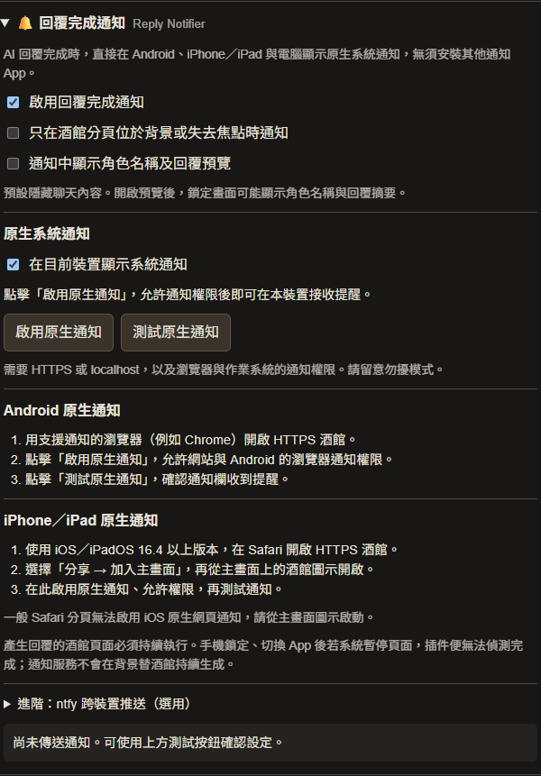

# 🔔 SillyTavern Reply Notifier｜酒館回覆完成通知

[](https://github.com/arno721/sillytavern-reply-notifier/actions/workflows/test.yml)
[](LICENSE)

AI 回覆完成後，發送系統通知。提供瀏覽器原生通知及可選的 **ntfy 手機推送**，適用於 Windows、macOS、Linux、Android 與 iOS 的下列接收方式。無須修改酒館原始碼、安裝伺服器插件或建置前端。

## 安裝

1. 在 SillyTavern 開啟 **擴充套件 → 安裝擴充套件**。
2. 貼上此倉庫網址：

   ```text
   https://github.com/arno721/sillytavern-reply-notifier.git
   ```

3. 安裝後重新整理，在擴充套件設定找到 **🔔 回覆完成通知**。
4. 點擊 **允許系統通知**，再點擊 **測試系統通知**。

使用 SillyTavern 1.13.0 以上版本；建議更新至目前穩定版。事件介面已對照官方 release 1.19.0 原始碼。插件安裝不需要執行 `npm install`；本倉庫的 Node.js 工具僅供開發及測試。

## 平台與條件

| 接收裝置 | 通知方式 | 設定條件 |
| --- | --- | --- |
| Windows | Chrome／Edge／Firefox 原生系統通知，或 ntfy 網頁接收 | HTTPS 或 localhost；允許網站及系統通知 |
| macOS | 支援通知的 Safari／Chrome／Firefox，或 ntfy 網頁接收 | HTTPS 或 localhost；允許瀏覽器及系統通知 |
| Linux | 支援通知的 Chrome／Firefox，或 ntfy 網頁接收 | HTTPS 或 localhost；桌面環境需支援通知 |
| Android | Service Worker 原生通知，或 ntfy App | 原生通知需 HTTPS 或 localhost；手機必須允許通知 |
| iOS／iPadOS | **建議用 ntfy App 接收**；原生網頁通知也提供 API 支援 | 原生方式需 iOS／iPadOS 16.4+、HTTPS、加入主畫面並從圖示開啟，且瀏覽器提供所需 API |

**執行限制：插件在產生回覆的酒館頁面中偵測完成。** 若這個頁面被關閉，或手機系統在鎖定／切換 App 後暫停它，插件便不能在暫停期間偵測完成或送出通知。Service Worker 不會替酒館在背景持續生成。

若希望鎖定 iPhone／Android 後接收通知，請在電腦或另一台裝置保持產生回覆的酒館頁面執行，再透過 ntfy 推送到手機。已送達的 ntfy 通知由手機 App 接收，不依賴手機酒館分頁保持開啟。

這是依平台 API 設計的相容方案，**並非五種作業系統的實機測試認證**。已驗證的自動化範圍見下方。

## iOS／Android：設定 ntfy

1. 依照 [ntfy 官方手機安裝說明](https://docs.ntfy.sh/subscribe/phone/) 安裝 App 並允許通知。
2. 在插件中開啟 **推送到 ntfy**，設定伺服器，例如 `https://ntfy.sh`，或自己的 ntfy 伺服器。
3. 點擊 **產生隨機 Topic**。
4. 在手機 App 訂閱**相同伺服器與 Topic**。
5. 點擊 **測試 ntfy 推送**，確認手機收到範例通知。

需要驗證的伺服器可填入存取權杖。手機端的私人主題也需使用有訂閱權限的帳號。

**自架伺服器與 iOS：** 即時通知需要依照 [ntfy 的 iOS 即時通知設定](https://docs.ntfy.sh/config/#ios-instant-notifications) 設定 APNs 連接的上游；通常是 `upstream-base-url: https://ntfy.sh`。沒有這項設定時，不保證 iOS 能即時收到。手機也必須能連到你設定的伺服器。

自架端點需允許酒館來源的 CORS 請求，包括 JSON 發布及選用的 `Authorization` 標頭。HTTPS 酒館連到 HTTP ntfy 可能被瀏覽器的混合內容政策阻擋，建議使用 HTTPS ntfy。伺服器可帶有反向代理路徑，例如 `https://example.com/ntfy/`；不要在伺服器欄位加上 Topic、帳密或查詢參數。

## 功能與設定

- 在成功回覆完成後通知；支援串流、非串流、重新生成與繼續生成。
- 群聊一次生成結束後合併為一則通知。
- 排除停止生成、失敗串流、靜默生成、代替使用者發言、初始問候及系統訊息。
- 可選擇只在酒館分頁位於背景或失去焦點時通知。
- 通知預設只顯示「AI 回覆已完成」，可手動開啟角色名稱與回覆預覽。
- 點擊原生通知可回到酒館；不接管酒館的根 Service Worker，也不攔截網路請求。
- 原生與 ntfy 可同時啟用；其中一個失敗不會阻止另一個，也不會中斷酒館生成。
- 設定面板顯示授權狀態及最近的發送結果，提供各通道獨立測試按鈕。

測試按鈕會發送範例通知，並略過總開關與「只在背景通知」條件。

<details>
<summary>查看設定介面（測試樣板）</summary>



</details>

## 隱私

- **ntfy 預設關閉**；未啟用時不會向第三方發送通知資料。
- **預覽預設關閉**。開啟後，角色名稱和回覆摘要會進入系統通知；啟用 ntfy 時也會傳到指定伺服器。推理欄位不會讀取。
- 公開 ntfy 主題通常可被知道 Topic 的人訂閱；隨機 Topic 是存取秘密，不等於權限控管。需要存取控制時請使用已設權限的私人主題。
- 一般偏好、伺服器及 Topic 存在酒館使用者設定中。選填的權杖僅存於目前分頁的 `sessionStorage`，不寫入酒館設定或 `localStorage`；瀏覽器恢復工作階段時可能恢復分頁資料。
- 發送時不夾帶酒館 Cookies；錯誤訊息不顯示伺服器回應正文、權杖或聊天內容。
- 通知連結移除網址中的帳密、查詢參數與片段。若你的登入方式依賴查詢參數，點擊後可能需要重新登入。

## 疑難排解

| 現象 | 檢查方式 |
| --- | --- |
| 安裝時顯示失敗，請求回傳 HTTP 502 | 檢查酒館後端與反向代理日誌。等前一個安裝請求結束後，用上面的完整 `.git` 倉庫網址重試；避免連續發送同一插件的安裝請求。502 本身不足以判斷插件檔案是否有問題。 |
| HTTP 區域網路網址沒有原生通知 | `http://192.168.x.x` 不是安全來源。設定 HTTPS，或使用 ntfy 接收。手機的 localhost 是手機本身。 |
| iPhone 的普通瀏覽器分頁沒有通知權限 | 使用 ntfy App，或改以 HTTPS 主畫面網頁 App 啟動酒館。 |
| 授權後仍看不到通知 | 檢查 OS 通知權限、勿擾模式及瀏覽器網站設定；通知可能只出現在通知中心。 |
| 手機鎖定後沒收到 | 確認產生回覆的酒館頁面仍在執行。若只在手機開酒館，系統可能已暫停頁面。 |
| ntfy 顯示 HTTP 401／403 | 檢查權杖是否有該 Topic 的發布權限。 |
| ntfy 顯示 HTTP 429 | 檢查服務端的額度／限流規則。 |
| 自架 ntfy 在 iOS 延遲或不通知 | 檢查 APNs 上游設定、App 的伺服器／Topic、網路及通知權限。 |
| 通知點擊後沒有直接回到原聊天 | 插件以安全的酒館頁面網址返回；已有同路徑視窗時會優先聚焦它。 |

## 開發與驗證

需要 Node.js 20+。

```sh
npm ci
npm test
npm run check
npx playwright install chromium webkit
npm run test:browser
```

GitHub Actions 在 Windows、macOS、Linux 執行單元測試，並在 Linux 執行 Chromium／WebKit 瀏覽器整合測試。Chromium 使用完整瀏覽器的新版 headless 模式；舊 headless shell 會硬性封鎖通知。

本地驗證包含完成事件的兩種順序、中斷競態、群聊、隱私預設、真實本機 HTTP 發布與逾時、設定儲存、手機寬度版面、實際 Chromium Service Worker 註冊及通知儲存。WebKit 自動化不提供 OS 通知授權，因此該項原生通知測試只在 Chromium 執行。瀏覽器測試使用模擬酒館上下文；另已在實際 SillyTavern 1.19.0 環境確認 Git 安裝與設定面板載入。**尚未驗證真實 API 生成的完整端到端或 iOS／Android 實機通知**。

實機確認建議：在每台接收裝置完成授權／訂閱後，按通道的測試按鈕，再產生一次正常回覆並驗證停止生成不會誤報。

## 參考

- [SillyTavern 擴充套件介面](https://docs.sillytavern.app/for-contributors/writing-extensions/)
- [Apple WebKit：iOS 主畫面網頁通知](https://webkit.org/blog/13878/)
- [ntfy JSON 發布 API](https://docs.ntfy.sh/publish/#publish-as-json)

MIT License © 2026 arno721
